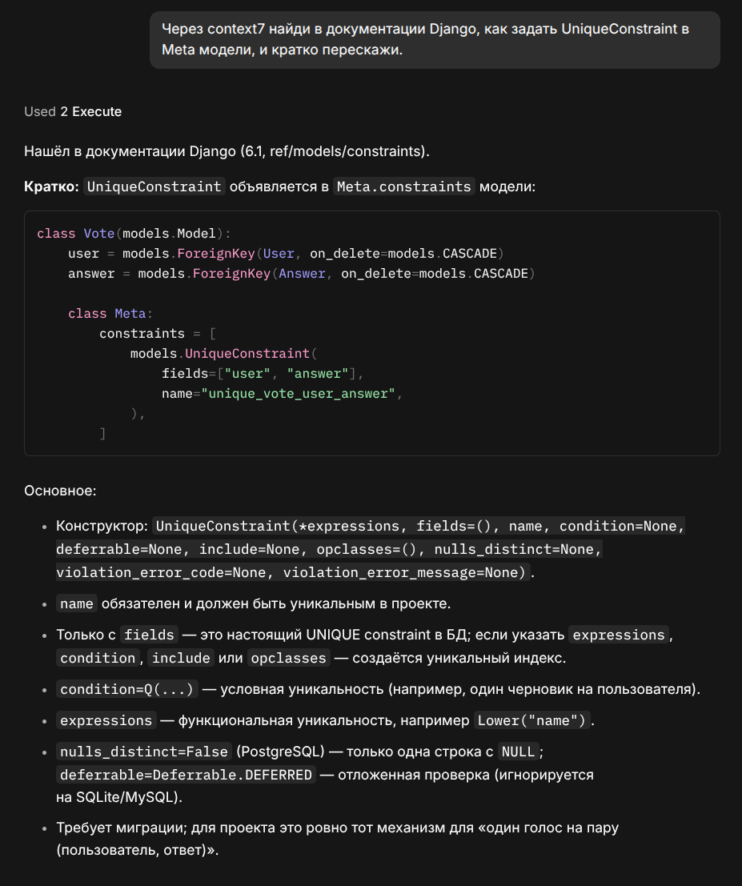
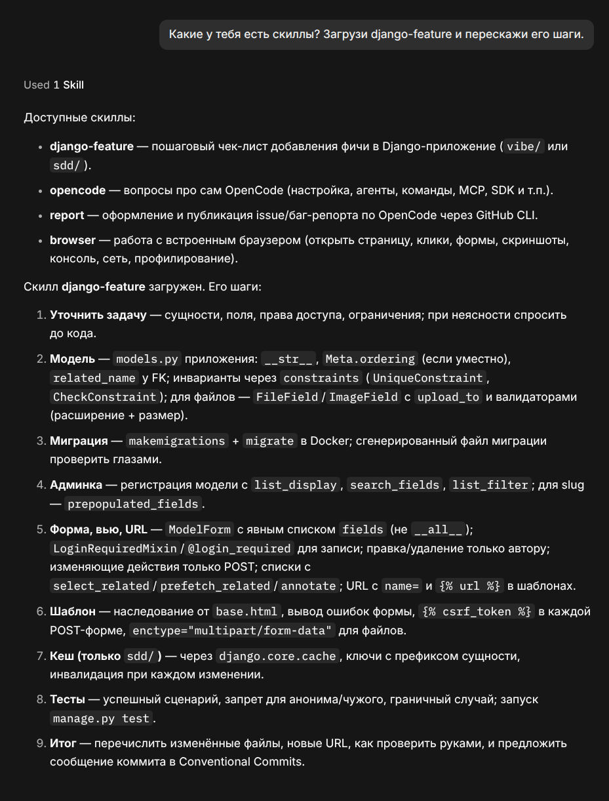

# Отчёт «на 3»: настройка агента

## Агент

- opencode v2.2.7
- Модель: `opencode/deepseek-v4.1-flash-free` (бесплатная модель OpenCode, без API-ключа)

## MCP-сервер

Подключён remote MCP-сервер **context7** — поиск по актуальной документации библиотек.
Конфигурация — в [`opencode.json`](../opencode.json).

```bash
opencode mcp add context7 --url https://mcp.context7.com/mcp
opencode mcp list   # ✓ context7  connected
```

**Проверка.** Промпт:

```
Через context7 найди в документации Django, как задать UniqueConstraint в Meta модели, и кратко перескажи.
```

Агент сделал два вызова MCP (в интерфейсе opencode v2 они отображаются как «Execute» — вызовы инструментов через code mode):

1. `context7.resolve-library-id` — `{"libraryName": "Django", "query": "UniqueConstraint in Meta constraints"}` → нашёл библиотеку Django;
2. `context7.query-docs` — `{"libraryId": "/websites/djangoproject_en", ...}` → получил раздел `ref/models/constraints` документации Django 6.1.

Ответ основан на документации, а пример сразу привязан к задаче проекта — уникальный голос на пару (пользователь, ответ).



## Skill

[`django-feature`](../.opencode/skills/django-feature/SKILL.md) — пошаговый чек-лист добавления фичи в Django-проект:
модель → миграция → админка → форма/вью/URL → шаблон → кеш (sdd) → тесты → итог с сообщением коммита.

**Проверка.** Промпт:

```
Какие у тебя есть скиллы? Загрузи django-feature и перескажи его шаги.
```

Агент нашёл `django-feature` среди доступных скиллов (рядом со встроенными `opencode`, `report`, `browser`), загрузил его инструментом Skill (`{"id": "django-feature"}`) и пересказал все 9 шагов.



## AGENTS.md

[`AGENTS.md`](../AGENTS.md) — контекст, который opencode автоматически подгружает в каждую сессию:

- описание предметной области и двух версий приложения (`vibe/`, `sdd/`);
- стек и версии, структура папок, команды запуска через Docker Compose;
- правила кода: секреты только из окружения, миграции, без N+1, рейтинг агрегатом, уникальность голоса в БД, права автора, валидация загрузок, тесты;
- указания использовать MCP context7 и скилл django-feature;
- запреты: не коммитить `.env`/`media/`, не переписывать историю git, не трогать `docs/` без просьбы.

Влияние видно уже в проверке MCP: без подсказки в промпте агент привёл пример именно для модели голосов `Vote(user, answer)` из описания проекта.
